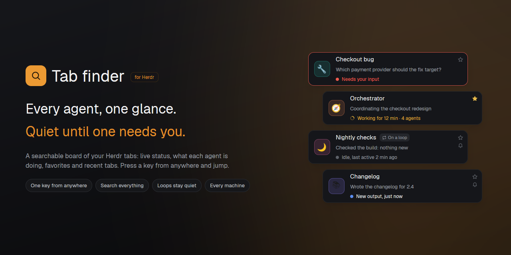
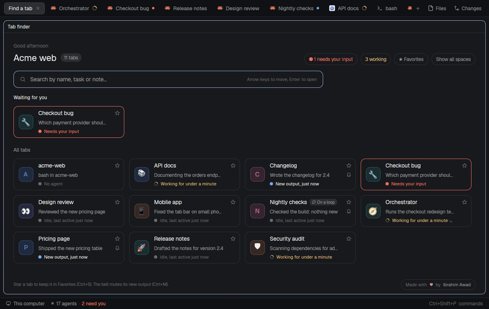
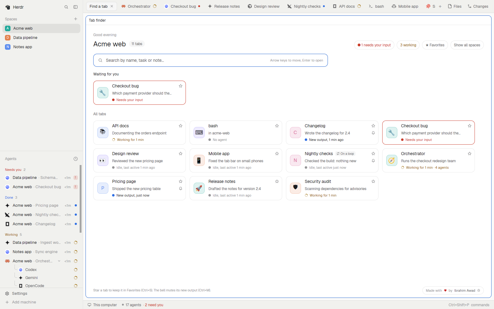
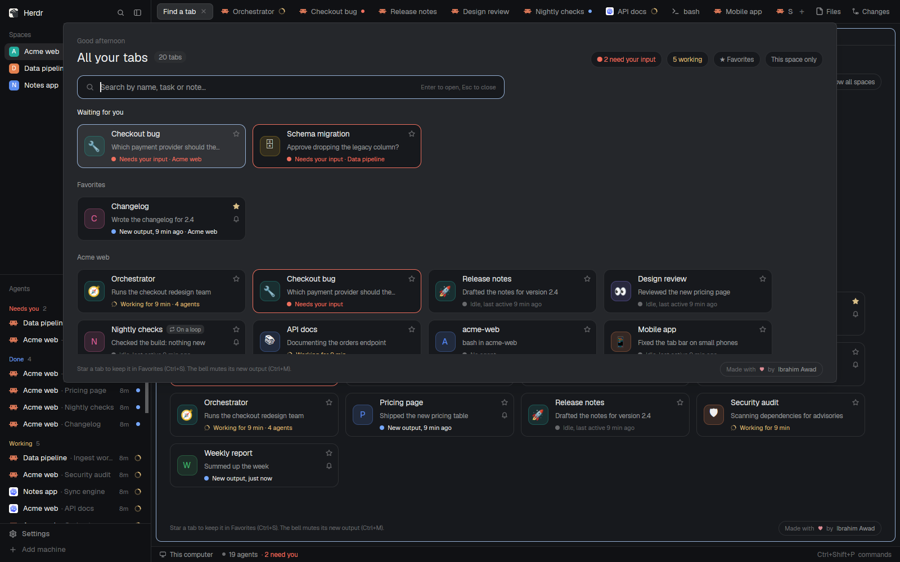

<p align="center">
  
</p>

<p align="center">
  <a href="https://github.com/ibrahimawadhamid/herdr-tab-finder/actions/workflows/check.yml"></a>
  <a href="https://github.com/ibrahimawadhamid/herdr-tab-finder/releases/latest"></a>
  <a href="https://herdr.dev/mods/ibrahimawadhamid/herdr-tab-finder"></a>
  
  
  <a href="LICENSE"></a>
</p>

<p align="center">
  <b>Running a dozen coding agents in <a href="https://herdr.dev">Herdr</a>? Tab finder shows every one of them on one board,<br>
  lets you jump to any tab in a keystroke, and stays quiet until an agent actually needs you.</b>
</p>

<p align="center">
  
</p>

## Why you'll like it

- 🔎 **Find anything in a keystroke.** Press one key from anywhere, type a few letters, hit Enter. It
  searches tab names, what each agent is doing, your notes, spaces and machines, and forgives typos
  and accents.
- 🔕 **Only what needs you gets loud.** An agent waiting for your answer gets a red border and goes to
  the top. Finished work gets a quiet "New output" mark. Agents on `/loop` or a schedule are spotted on
  their own and never nag; a bell mutes anything else.
- 🧭 **The whole fleet at a glance.** One card per tab: its status, how long it's been working, how
  many agents and helpers run in it, and the line it's working on.
- ⭐ **Favorites and recent tabs** right at the top, across every layout.
- 🖥️ **Every space, every machine.** Tabs on your servers are labelled; one that goes offline is marked,
  not hidden.
- ⌨️ **Keyboard first, mouse friendly.** Arrows, Enter, Ctrl+S to star, Ctrl+M to mute. Screen-reader
  labels and tooltips throughout.
- 🎨 **Feels native.** It follows your Herdr theme, light or dark, and your zoom, from a narrow side pane
  to a wide screen, and keeps up with hundreds of tabs.
- 🔒 **Private by design.** No network, no programs, no telemetry. It only reads what Herdr already shows
  you.

| Light theme | As a popup, over anything |
|---|---|
|  |  |

## Install in ten seconds

**Ask your agent.** In Herdr, tell your coding agent:

> Read ~/.config/herdr-app/AGENTS.md, then add this mod: herdr.dev/mods/ibrahimawadhamid/herdr-tab-finder

**macOS and Linux:**

```sh
curl -fsSL https://raw.githubusercontent.com/ibrahimawadhamid/herdr-tab-finder/main/install.sh | sh -s -- --bind
```

**Windows (PowerShell):**

```powershell
& ([scriptblock]::Create((irm https://raw.githubusercontent.com/ibrahimawadhamid/herdr-tab-finder/main/install.ps1))) -Bind
```

That's it. Press **cmd-e** on macOS or **ctrl-shift-g** on Linux and Windows, anywhere in Herdr.

`--bind` adds that shortcut only if the key is free, after backing up `keys.json`. Leave it out to
install without one. The installers never overwrite your own settings, and running them again updates
Tab finder in place. Needs the Herdr app 0.1.16 or later.

<details>
<summary><b>Install by hand</b></summary>

Copy the `mods/Tab finder` folder into Herdr's `mods` folder: `~/.config/herdr-app/mods/` (or
`$XDG_CONFIG_HOME/herdr-app/mods/`, or `$HERDR_APP_HOME/mods/`). Keep the folder name: Herdr shows it as
the pane's title. For a shortcut, add this to the `"global"` section of `keys.json` (`cmd-e` on macOS):

```json
"ctrl-shift-g": "mod.open:Tab finder"
```

Both keys are free in Herdr's default shortcuts. (`ctrl-shift-e` is not: Herdr uses it to split a pane
down on Linux and Windows.)
</details>

## Use it

**As a popup**, from anywhere: press the shortcut, type, press Enter. The popup closes as you land.
"This space only" narrows it to the space you're in, and it remembers your choice.

**As a tab** that stays open: `herdr-app do tab.new '{"name":"Find a tab","mod":"Tab finder"}'`. It shows
the tabs of its own space; "Show all spaces" shows everything. It also works in a side block or a
floating block of your own layout.

| Do this | To |
|---|---|
| Type | Search names, tasks, notes, spaces and machines |
| ↑ ↓, Page Up, Page Down | Move between cards (past the last one: the next page) |
| ← → | Move between cards (while searching, from either end of the text) |
| Enter | Open the selected card, or the first result |
| Ctrl+S | Star or unstar the selected card |
| Ctrl+M | Mute or unmute its new output |
| Esc | Clear the search; in the popup, close it |
| Click a card, ☆ or the bell | Open it, star it, or mute it |
| Click a status at the top | Show only those tabs; click again for all |

<details>
<summary><b>Bind Tab finder's own commands</b></summary>

Under a `"mod:Tab finder"` section of `keys.json` (active while the board has the keyboard):
`"Tab finder.favorite"`, `"Tab finder.mute"`, `"Tab finder.clear"`, and `"Tab finder.focus"`, which puts
the cursor in the search box. `pane.go` also moves onto a board pane.
</details>

## Make it yours

Both files are optional. Put them next to `main.js` in `mods/Tab finder/`; Herdr reloads the board when
you save, and updates never touch them. If one isn't valid JSON, the board says so in red and carries on.

**`config.json`**

```json
{ "title": "Find an agent", "name": "Sam", "space": "Agents", "noun": "agent", "icons": "auto" }
```

| Field | What it does | Default |
|---|---|---|
| `title` | The heading of a board tab | the space's name |
| `name` | Adds your name to the greeting | none |
| `space` | Which space a board tab shows | the space it was opened in |
| `noun` | What to call tabs: "12 agents", "All agents" | "tab" |
| `icons` | `"emoji"` (🚀 release, 🔧 fix, 📚 docs, …) or `"letters"` | `"auto"`: emoji where an emoji font is installed |

**`notes.json`**: one line per tab, shown under its name and searchable. Use `"Space / Tab"` when two
spaces have a tab with the same name.

```json
{ "Orchestrator": "Runs the checkout redesign team", "Data pipeline / Backfill": "Rerun on Fridays" }
```

A board tab also takes props: `{"space": "Agents"}` pins a space, `{"scope": "all"}` starts with every
space.

## For teams and companies

<details>
<summary><b>Privacy, data, rollout and support</b></summary>

- **Privacy.** Tab finder reads only Herdr's own view of your spaces, tabs and agents, plus its two
  optional files. It never reaches the network, runs programs, reads other files or sends telemetry. Its
  only actions are selecting the tab you pick and saving its own state. See [SECURITY.md](SECURITY.md).
- **Data.** Favorites, mutes, recent tabs and recent finishes live in Herdr's `shared.json` under
  `tabfinder.*`, on each computer. They don't sync between computers.
- **Rollout.** The installers run unattended, are safe to rerun, and exit 0 (done), 1 (failed) or
  2 (bad option). Pin a version with `TAB_FINDER_REF=v1.0.0` (`-Ref`), install from an internal mirror
  with `TAB_FINDER_URL=https://…/tab-finder.tar.gz` (`-Url`), choose another folder name with
  `TAB_FINDER_NAME` (`-Name`), and point at a custom Herdr folder with `HERDR_APP_HOME` (`-AppHome`).
- **Quality.** Every change, and every Monday against the newest Herdr, CI loads the mod in Herdr and
  runs both installers on Linux, macOS and Windows (PowerShell 7 and Windows PowerShell 5.1).
- **Support.** Questions and ideas in [Issues](https://github.com/ibrahimawadhamid/herdr-tab-finder/issues);
  security reports privately, as [SECURITY.md](SECURITY.md) explains.
</details>

## Good to know

- "New output" clears once you look at the tab, from any Herdr window, and after Herdr restarts.
- A new looper is recognised after 3 finishes within an hour, counted while Herdr is open.
- A tab holding a Tab finder pane isn't listed on its own board.
- Adding a shortcut makes `keys.json` yours, and Herdr then stops adding new default shortcuts to it.
  That's Herdr's rule for any edit to the file.
- Herdr's own tab bar and agents list struggle at around 250 tabs in one space; Tab finder stays usable
  there by showing 100 cards per page.

## Uninstall

```sh
sh install.sh --uninstall            # keeps your config.json and notes.json
sh install.sh --uninstall --purge    # removes them too
```

On Windows: `.\install.ps1 -Uninstall` (add `-Purge`). Either one also removes the shortcut it added.

---

<p align="center">
  Made with ❤️ by Ibrahim Awad · <a href="LICENSE">MIT license</a> · <a href="CHANGELOG.md">Changelog</a> · <a href="RECIPE.md">Build recipe</a>
</p>
