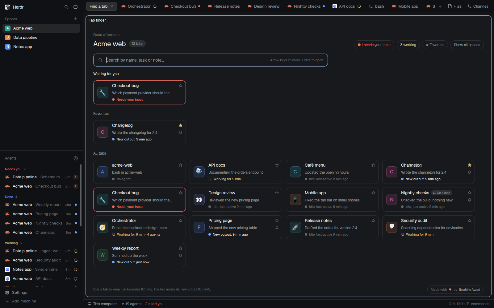

# Tab finder

Find any tab in [Herdr](https://herdr.dev) at a glance. Tab finder is a searchable board of your tabs as
cards: what each agent is working on, its live status, how many agents run in each tab, favorites and
recent tabs. It's built for people who run many agents at once, such as an orchestrator plus a crowd of
helpers, and it stays quiet: only tabs that need your input are highlighted.



## What it does

- **One card per tab**: the tab's name, what its agent is doing (or your own note), and its status:
  needs your input, working (and for how long), new output, idle, or no agent.
- **Quiet by design.** Only tabs that need your input get a red border, a count at the top and a place
  under "Waiting for you". A tab whose agent finished while you were away gets a small "New output" mark,
  nothing louder.
- **Agents on a loop stay out of your way.** A tab that finishes 3 or more times within an hour (an agent
  on `/loop` or a schedule) is marked "On a loop" and never highlighted. The bell on a card mutes "New
  output" for any other tab.
- **Search** by name, task, note, space or machine, without caring about case or accents ("cafe" finds
  "Café"). "chlg" finds "Changelog" when nothing else matches.
- **Favorites and recent tabs** at the top, kept across layouts. Recent skips the tab you're on.
- **Every space, every machine.** In a tab it shows its own space, or all of them with one click. As a
  popup it shows everything, or only the space you're in. Tabs on other machines are labelled; machines
  that can't be reached are marked offline.
- **Keyboard first.** Type, move with the arrow keys, open with Enter, star with Ctrl+S, mute with Ctrl+M.
  Cards, stars and bells carry screen-reader labels and tooltips.
- Follows your theme (light and dark) and Herdr's zoom, from a narrow side pane to a wide screen. Copes
  with hundreds of tabs (it shows them 100 at a time; search always covers every tab).

| Light theme | Popup over anything |
|---|---|
|  |  |

## Install

You need the Herdr app 0.1.16 or later (tested on 0.1.16 and 0.1.18, on macOS and Linux).

**Ask your agent.** In Herdr, tell your coding agent: "add the Tab finder mod from herdr.dev/mods". It
follows RECIPE.md and Herdr's own guide.

**macOS and Linux**, one line (downloads this release and installs it):

```sh
curl -fsSL https://raw.githubusercontent.com/ibrahimawadhamid/herdr-tab-finder/main/install.sh | sh -s -- --bind
```

Or from a downloaded copy of this folder: `sh install.sh --bind`.

**Windows** (PowerShell):

```powershell
& ([scriptblock]::Create((irm https://raw.githubusercontent.com/ibrahimawadhamid/herdr-tab-finder/main/install.ps1))) -Bind
```

Or from a downloaded copy: `.\install.ps1 -Bind`.

`--bind` (`-Bind`) adds a shortcut that opens Tab finder as a popup: **cmd-e** on macOS, **ctrl-shift-g**
on Linux and Windows. Both are free in Herdr's default keys. Leave it out to install without a
shortcut. The installers:

- never overwrite your `config.json` or `notes.json`;
- touch `keys.json` only when asked: they add the shortcut only if that key is free, keep a backup, and
  never replace a key you already use;
- check the mod with `herdr-app check` when Herdr's command is on your PATH;
- update in place when run again.

**By hand.** Copy the `mods/Tab finder` folder into Herdr's `mods` folder: `~/.config/herdr-app/mods/`
(or `$XDG_CONFIG_HOME/herdr-app/mods/`, or `$HERDR_APP_HOME/mods/`). Keep the folder name: Herdr shows it
as the pane's title. For a shortcut, add this to the `"global"` section of `keys.json` (`cmd-e` on
macOS):

```json
"ctrl-shift-g": "mod.open:Tab finder"
```

## Open it

- **As a popup**, from anywhere: press the shortcut, or run `herdr-app do mod.open '{"name":"Tab finder"}'`.
  Pick a tab and the popup closes. Esc or the shortcut closes it too. "This space only" narrows it to the
  space you're in, and it remembers your choice.
- **As a tab** that stays: `herdr-app do tab.new '{"name":"Find a tab","mod":"Tab finder"}'`. It shows the
  tabs of the space it lives in; "Show all spaces" shows everything. The search box takes the keyboard each
  time the tab comes to the front, and `pane.go` reaches it from a pane beside it.

## Use it

| Do this | To |
|---|---|
| Type | Search names, tasks, notes, spaces and machines |
| Up, Down, Page Up, Page Down | Move between cards (past the last card: the next page) |
| Left, Right | Move between cards (while searching, from either end of the text) |
| Enter | Open the selected card, or the first result |
| Ctrl+S | Star or unstar the selected card |
| Ctrl+M | Mute or unmute the selected card's new output |
| Esc | Clear the search; in the popup, close it |
| Click a card | Open that tab |
| Click ☆ | Add or remove a favorite |
| Click the bell | Mute or unmute "New output" for that tab |
| Click a status at the top | Show only those tabs; click again for all |

You can also bind keys to Tab finder's own commands in `keys.json`, under a `"mod:Tab finder"`
section (they act while the board has the keyboard): `"Tab finder.favorite"`, `"Tab finder.mute"`,
`"Tab finder.clear"`, and `"Tab finder.focus"` (puts the cursor in the search box).

## Make it yours (optional)

Put either file next to `main.js` in `mods/Tab finder/`. Herdr reloads the board when you save. Both are
yours: updates never touch them. If one isn't valid JSON, the board says so in red at the bottom and
carries on without it.

`config.json`, every field optional:

```json
{
  "title": "Find an agent",
  "name": "Sam",
  "space": "Agents",
  "noun": "agent",
  "icons": "auto"
}
```

| Field | What it does | Default |
|---|---|---|
| `title` | The heading of a board tab | the space's name |
| `name` | Adds your name to the greeting | none |
| `space` | Which space a board tab shows | the space it was opened in |
| `noun` | What to call tabs ("12 agents", "All agents") | "tab" |
| `icons` | `"emoji"` for pictures matched from tab names (🚀 release, 🔧 fix, 📚 docs, …), `"letters"` for first letters | `"auto"`: emoji where an emoji font is installed |

`notes.json`, one line per tab, shown under its name and searchable:

```json
{
  "Orchestrator": "Runs the checkout redesign team",
  "Data pipeline / Backfill": "Old data, rerun on Fridays"
}
```

Use `"Space / Tab"` when two spaces have tabs with the same name.

A board tab also takes props, for layouts and scripts: `{"space": "Agents"}` to pin a space,
`{"scope": "all"}` to start with every space. It works in a layout block or a floating block too.

## For teams and companies

- **Privacy.** Tab finder reads only Herdr's own view of your spaces, tabs and agents, and its two
  optional files. It never reaches the network, runs programs, reads other files or sends telemetry. It
  changes nothing in Herdr except selecting the tab you pick and its own entries in shared state.
- **Where its data lives.** Favorites, mutes, recent tabs and recent finishes are kept in Herdr's
  `shared.json` under `tabfinder.*`, on each computer. They don't sync between computers.
- **Rolling it out.** The installers run unattended, are safe to run again, and exit with 0 (done),
  1 (failed) or 2 (bad option). Pin a version with `TAB_FINDER_REF=v1.0.0` (`-Ref v1.0.0`). Install from
  an internal mirror with `TAB_FINDER_URL=https://…/tab-finder.tar.gz` (`-Url`). Use another folder name
  with `TAB_FINDER_NAME` (`-Name`) if "Tab finder" is taken. Point at a non-default Herdr folder with
  `HERDR_APP_HOME` (`-AppHome`).
- **Checked automatically.** Every change, and every Monday against the newest Herdr, CI loads the mod
  in Herdr and runs both installers on Linux, macOS and Windows.

## Good to know

- "New output" clears once you look at the tab, from any Herdr window, and after Herdr restarts.
- Loop detection counts finishes seen while Herdr is open. A new looper needs 3 finishes within an hour
  before it's marked.
- A tab that holds a Tab finder pane isn't listed on the board.
- Adding a shortcut to `keys.json` makes the file yours, and Herdr then stops adding new default
  shortcuts to it. That's Herdr's rule for every edit to `keys.json`.
- Herdr's own tab bar and agents list struggle at around 250 tabs in one space; Tab finder stays usable
  there by paging.

## Uninstall

```sh
sh install.sh --uninstall            # keeps your config.json and notes.json
sh install.sh --uninstall --purge    # removes them too
```

On Windows: `.\install.ps1 -Uninstall` (add `-Purge`). Both also remove the shortcut they added. By
hand: delete `mods/Tab finder` and the `mod.open:Tab finder` line in `keys.json`. Favorites and mutes
stay in `shared.json` under `tabfinder.*` until you delete them there while Herdr is closed.

## Credits

Made with ❤️ by Ibrahim Awad. MIT licensed; see [LICENSE](LICENSE). Changes are listed in
[CHANGELOG.md](CHANGELOG.md), and [SECURITY.md](SECURITY.md) says how to report a security problem.
