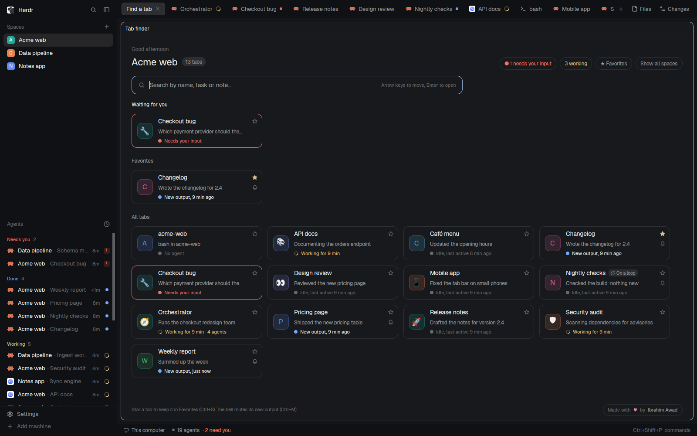

# Tab finder

A searchable board of your Herdr tabs as cards, for people who run many agents at once. Each card shows a
tab's name, what its agent is working on, and its live status. Only tabs that need your input are
highlighted, so agents on a loop don't bury the ones that do. It lives as a tab (the tabs of its space, or
every space with one click) or opens as a popup over anything with one key, and closes when you pick a tab.

## What you see

Top to bottom, inside the mod's block (24px padding on wide blocks, 14px under 560px wide; theme
`background`, or `popover` in the popup):

1. **Header row**, wrapping when narrow. On the left, a greeting in 12px `dim` ("Good morning", "Good
   afternoon", "Good evening", "Working late" before 5:00, with ", Name" when config.json has `name`). Under
   it the title in 22px bold `foreground`: the space's name, or config.json `title`, or "All your tabs"
   when showing every space; beside it a count pill (11.5px `muted` on `raised`, radius 10): "12 tabs"
   (or config.json `noun`: "12 agents"), plus "· on build-box" for a space on another machine. On the
   right, pills (11.5px, radius 14, 1px border): "● N need(s) your input" in `blocked`, "N working" in
   `working` (each only when nonzero), "★ Favorites", and "Show all spaces" / "Showing all spaces" in a
   pane, or "This space only" in the popup. An active pill gets an `accent` border and `accent` at 13% behind it.
2. **Search box**: 42px tall, full width up to 760px, radius 12, 1px `accent` border, `surface` fill, a
   16px search icon, placeholder "Search by name, task or note…", and a 11px `dim` hint on the right
   ("Arrow keys to move, Enter to open", "Esc to clear" while searching, "Enter to open, Esc to close" in
   the popup; hidden under 560px).
3. **Sections**, each a 12px semibold title (in `muted`; "Waiting for you" in `foreground`) over rows of
   cards with 12px gaps: "Waiting for you" (blocked tabs), "Favorites", "Recent" (up to 4), then "All tabs"
   (or "All agents" with a noun) sorted in natural order (Task 2 before Task 10). When showing every
   space: one section per space instead, titled "Name · on machine" for other machines. While searching:
   one section, "N results".
4. **Cards**: 78px tall; as many columns as fit at 260px or more, each at most 300px; one full-width
   column when the block is narrow. Radius 12, 1px `border`, `surface` fill. Left: a 36px tile, radius 10,
   in one of eight hues picked by a hash of the name (#5b8def #22a99a #e3814f #8b7cf6 #3fae6a #d9649a
   #c9a227 #4fb3d9) at 15% fill and 33% border, holding an emoji matched from the name (🚀 release, 🔧
   fix or bug, 🧭 orchestrator, 📚 docs, 🧪 test, …) or the name's first letter in the hue. Middle, three
   lines: the name (13.5px semibold `foreground`, plus an "On a loop" badge with a loop icon, 10px `muted`
   on `raised`), a subtitle (11.5px `muted`: the tab's note, else what its agent is doing, else "zsh in
   repo · branch"), and a status line (11px) after an 8px dot or a 10px spinner, with "· 4 agents", "· 2
   panes", or the space name when cards come from several spaces. Right, stacked: a 14px star (hollow
   `dim`, filled `ansi3` when a favorite) and, on tabs that finish on their own, a 14px bell (crossed out
   when muted).
5. **Paging line** (only past 100 cards): "Page 1 of 3. Search finds any tab." and a "Next page" pill at
   the bottom, "Previous page" at the top of later pages.
6. **Problems**, only when config.json or notes.json can't be used: one 11px line each in `blocked`,
   e.g. "config.json isn't valid JSON, so it is ignored (…)".
7. **Footer**: a 10.5px `dim` tip ("Star a tab to keep it in Favorites (Ctrl+S). The bell mutes its new
   output (Ctrl+M).", hidden when narrow) and a "Made with ♥ by Ibrahim Awad" pill (heart in `ansi1`).

Empty states, in 12.5px `muted`: "No other tabs in this space yet. Open one and it shows up here.",
"Nothing matches your search. Press Esc to clear it.", "No favorites yet. Click the star on a card to add
one.", "This space isn't here any more. Click Show all spaces to see every tab."

## How it behaves

- **Statuses** (a tab's status is its most urgent agent's):
  - blocked: `blocked` border, red dot, "Needs your input"; listed under "Waiting for you" and counted in
    the top pill. The only state that is highlighted.
  - working: spinning ring in `working`, "Working for 12 min"; counted in "N working".
  - done (finished while you weren't looking): a quiet mark only, `done` dot and "New output, 3 min ago"
    in `foreground`; no border, no pill.
  - On a loop: a tab that turned "done" 3 or more times within the last hour (an agent on /loop or a
    schedule). It gets the "On a loop" badge, and its "done" shows as plain "Idle, last active …".
  - Muted (the bell): the same quiet "Idle" for that tab's "done", until you click the bell again.
  - idle: gray dot, "Idle, last active 5 min ago"; tabs with no agent say "No agent, …"; settled tabs
    "Put away, still running".
  - A tab on a machine Herdr can't reach: "Offline right now", never highlighted or counted; its section
    title adds ", which can't be reached right now".
- **Clicks**: a card opens its tab (switching space first) and closes the popup; the star toggles the
  favorite; the bell toggles mute; status pills filter to that status (click again for all); "Show all
  spaces" switches scope (remembered per copy).
- **Keys**: typing searches the name, task, note, space and machine, ignoring case and accents (all
  words must match; when nothing does, the letters in order, so "chlg" finds "Changelog"); Up and Down move by row, Page Up and Page Down
  by four rows, Left and Right between cards (with search text, only from the ends of the text); moving
  past the last row turns the page; Enter opens the selected card, or the first result while searching or
  in the popup; Ctrl+S stars and Ctrl+M mutes the selected card (or the first result); Esc clears the
  search and filters in a pane. In the popup, Herdr closes it on Esc.
- **Hover**: cards take `hover` with an `accent` border; the selected card keeps them.
- **The popup** starts with every space, or only the space you're in when "This space only" was on the
  last time (remembered in shared state).
- **On its own**: the search box takes the keyboard each time the board's tab comes to the front, and
  when `pane.go` moves onto the board; "Recent" follows whichever tab is in front, opened from here or
  anywhere, and leaves out the one you're on; times refresh every minute.
- **Screen readers**: the list is a `list_box`; each card a `list_box_option` labelled with its name,
  subtitle and status, selected and announced as the active one while the search box keeps the keyboard;
  star and bell are labelled buttons with tooltips.

## Built from

- One mod, `mods/Tab finder/` (`main.js`, `mod.json`, `icons/*.svg`). `mod.json`:
  `{ "place": "none", "title": "Tab finder", "overlay": { "kind": "popup", "at": "top", "offset": 40,
  "width": 0.86, "height": 0.8 }, "focusable": true }`, so it never docks itself and `pane.go` can reach a
  board pane; it is opened as a popup with
  `mod.open {name: "Tab finder"}` or put in a tab with `tab.new {mod: "Tab finder", props}`.
- Props (optional): `space` (a space name or id to show; default: the space shown when the copy first
  appeared, remembered in localStorage) and `scope` (`"all"` to start with every space). In the popup
  (`props().overlay` set) it always shows every space.
- Optional files beside main.js, read once per load with `readTextFile` from
  `appHome()/mods/<its folder>/`: `config.json` (`title`, `name`, `space`, `noun`, `icons`: `auto`,
  `emoji` or `letters`) and `notes.json` (`"Tab name"` or `"Space / Tab"` → one line).
- `herdr`: `spaces()`, `panes()`, `agents()`, `terminals()` (each terminal's `parent`, to count
  sub-agents in a tab), `machines()`, `focused()`, `theme()`, `settings()` (zoom), `window()` and
  `fonts()` (emoji or letters), `placement()` (a floating block), `nextCommand()` (`focus` from
  `pane.go`; `favorite`, `mute`, `clear`, `focus` from keys.json's `"mod:Tab finder"` section),
  `shared`/`setShared`, `run("space.select")`, `run("tab.select")`, `closeOverlay`, `checking()`. Each
  list read is guarded, so a missing one leaves its part empty instead of breaking the board.
- `gpui-base`: `InputState`/`Input` for search, `ScrollHandle` to scroll the selected card into view.
- Shared state: `tabfinder.favorites`, `tabfinder.recent` (last 12), `tabfinder.muted`,
  `tabfinder.popup.scope` (`"all"` or `"space"`),
  `tabfinder.finishes` (per tab, when it last turned done; pruned to the last hour),
  `tabfinder.migrated` (a one-time copy of older `tabboard.*` favorites and recent tabs).
- Art: its own 24px stroke icons (search, spinner, star, star-filled, bell, bell-off, loop, heart), all
  `currentColor`, drawn with `svg()` so they take the theme.
- No programs, no network, no files outside its own folder.

## Watch out

- **The folder name is the pane title.** Herdr's pane header shows the mod's folder name, which is why the
  folder is "Tab finder" and not a slug. Keep the space: `mod.open:Tab finder` in keys.json works with it.
  The mod finds its own name at run time from `new Error().stack` (`import.meta.url` is undefined in
  Herdr mods), so a renamed copy still finds its icons, files and panes.
- **Render budget.** Herdr interrupts a render that takes too long. Around 250 cards it does (and
  Herdr's own tab bar and agents list do too at that size), so the board draws pages of 100 cards and
  works out each label and sort key once per render. Don't call `label()` inside a sort comparator.
- **`localeCompare` options are ignored** by Herdr's engine: `numeric: true` does nothing, so natural
  order is written out.
- **Sizes and zoom.** `on_size_change` reports zoomed pixels while `.w()` takes sizes at zoom 1; divide
  by `settings().zoom` or the columns are wrong at any zoom but 100%.
- **Popups and floating blocks grow with their content.** A `flex_1()` list inside one lays out at zero
  height; give it a height (here: its rows' height, at most 440px; `placement()` tells a floating copy).
- **Theme colors may carry alpha** (`#rrggbbaa`): tint them with a helper, never by appending hex digits.
- **Herdr's right-click menus are its own.** The space menu (Rename, worktrees, Close) is hard-coded in
  the shipped `menu` mod and can't be extended; only a layout's terminal menu can be replaced, whole. A
  mod that wants a menu entry would have to clone Herdr's sidebar and layout, which then stop getting
  Herdr's updates, so this one doesn't.
- **`herdr-app check` writes `jsconfig.json` and `gpui-kit.d.ts`** into the folder it checks; keep them
  out of the published folder (.gitignore does).
- **The mod's name in a stack trace** may use `\` on Windows; match both slashes.
- **Esc in a popup** is Herdr's: it closes the popup before the mod sees the key.
- **Home and End** stay in the search box; only arrows and Page Up/Down move between cards.
- **Virtual lists** can't hold per-card click handlers (only `on_item_click` per row), so a grid with a
  star and a bell per card can't use one; that is why paging was chosen.
- **Unreachable machines** keep their last known spaces in `spaces()`; their statuses are stale.
- **Tabs holding a Tab finder pane are left out of the board**, including a terminal split beside it.
- **"done" turns "idle"** once you look at the tab on any Herdr client, and after Herdr restarts, so "New
  output" disappears then; loop detection counts only finishes seen while Herdr runs.
- **Emoji tiles** need an emoji font. `icons: "auto"` uses emoji on macOS and Windows, and on Linux only
  when a font with "emoji" in its name is installed; otherwise letters.
- **Keys.** ctrl-shift-e is Herdr's default for splitting down on Linux, so the suggested key is
  ctrl-shift-g (free in Herdr 0.1.18), or cmd-e on macOS. Editing keys.json makes it yours: Herdr stops
  adding new default shortcuts to it.

## Done when

- `herdr-app check "mods/Tab finder"` passes.
- `mod.open {name: "Tab finder"}` opens a popup titled "All your tabs" with the search box focused;
  typing part of a tab's name and pressing Enter switches to that tab, in another space too, and the
  popup closes.
- In a tab (`tab.new {mod: "Tab finder"}`), the board shows that space's other tabs, not its own tab.
- An agent reporting `blocked` (OSC 7501 `state=blocked`) appears under "Waiting for you" with a red
  border and is counted in "1 needs your input"; one reporting `done` shows "New output" with no border.
- A tab that turns done 3 times within an hour shows "On a loop" and stays unhighlighted; the bell mutes
  "New output" on another tab.
- With 250 tabs in a space, the board renders, shows "Page 1 of 3", and Down past the last row opens page
  2.
- Tabs named "Task 2" and "Task 10" sort in that order; "cafe" finds "Café menu".
- Ctrl+S on the selected card adds it to Favorites (filled star); Ctrl+M crosses out its bell.
- An invalid config.json shows a red line at the bottom; the board still works.
- With a terminal split beside a board, `pane.go` toward the board puts typing in its search box.
- At zoom 67% the cards fill the row with more columns, not fewer.
- Narrower than 560px, one full-width column, no hint and no tip.
- A space on an unreachable machine shows "Offline right now" on its cards and is not counted.
